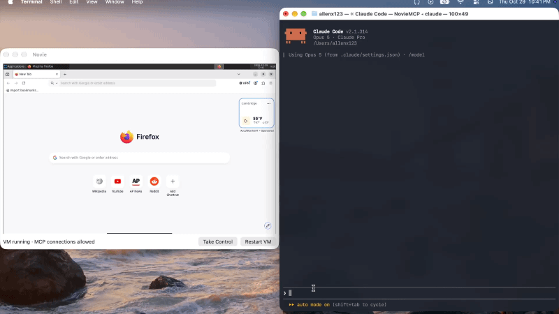

<h1 align="center">
  
</h1>

A macOS 26+ desktop app (Apple silicon) that runs an Alpine Linux XFCE desktop in a VM and hands
its mouse and keyboard to another agent over [MCP](https://modelcontextprotocol.io). The app shows
the VM's screen, plays lists of mouse, keyboard and wait actions into it and answers each list with
a screenshot, and lets you take over the VM's mouse and keyboard yourself.

The guest is aarch64, so QEMU runs it on `-accel hvf` — Hypervisor.framework, the same hardware
virtualization Apple's Virtualization.framework is built on. The guest's instructions run on the
Mac's own cores rather than being emulated, so the desktop boots in seconds and feels like a
desktop.

Nothing of ours runs inside the VM. Actions go in through QEMU's VNC server as events from the
emulated tablet and keyboard, and screenshots come out of the framebuffer the window is already
drawing — so there's no agent, no Python and no listening port in the guest, and it can be driven
from the first frame of the boot screen.

## Demo



## Build and run

To build you need an Apple silicon Mac on macOS 26 or later with:

- the Xcode command line tools (`xcode-select --install`): `swiftc`, `codesign`,
  `install_name_tool` and `python3`
- [Homebrew](https://brew.sh), then `brew install qemu`
- internet access on the first build, for the ISO and the guest's packages

```sh
brew install qemu
./build.sh                      # builds the guest image on the first run (several minutes)
open "build/Novie.app"
```

The first build downloads the Alpine Linux 3.24.3 aarch64 ISO (about 90 MB), checks its SHA-256,
and installs Alpine and XFCE onto a disk image in a throwaway VM. That image is cached in
`guest/image/`, so later builds take about half a minute; `./build.sh --force-image` builds it
again.

1. Turn on **Novie → Allow MCP Connections** and connect an agent (below). It's off until you do.
2. The desktop appears in about 20 seconds. It's XFCE, with a terminal, a file manager and
   Firefox, logged in as root.
3. **Take Control** (⇧⌘K) forwards your mouse and keyboard to the VM (orange border) and locks
   connected agents out until you click it again. ⌘ shortcuts stay with macOS; use Control for
   shortcuts inside the VM.
4. **Hide Novie** (⌘H) gets the window out of the way while an agent keeps working in it.
5. Quitting (⌘Q or closing the window) saves the VM to disk — 1–2 GB and 10–20 seconds, depending
   on what's running in it — and the next launch resumes it where you left off in a couple of
   seconds, browser windows and all. **Restart VM** or **Quit Without Saving VM** (⌥⌘Q) discards it and boots fresh
   next time, as does rebuilding the app. Nothing else in the VM persists: everything the guest
   writes goes to a disk overlay that each fresh boot throws away.

## Letting an agent use Novie (MCP)

Point any MCP client — Claude Code, or anything else that speaks MCP — at the app's own binary:

```sh
claude mcp add --scope user novie -- "/path/to/Novie.app/Contents/MacOS/NovieMCP" --mcp
```

There is nothing extra to install: `--mcp` runs the same binary as a stdio MCP server that forwards
to the open Novie window over a Unix socket. Novie has to be running, and the tool says so if it
isn't.

There's one tool, **`computer`**. It takes a list of actions, plays them into the VM in order, and
always answers with a screenshot of the screen afterwards — so an empty list is how a client just
looks at the screen. Coordinates are pixels in that screenshot.

```json
{"actions": [{"action": "left_click", "coordinate": [640, 400]},
             {"action": "type", "text": "hello"},
             {"action": "key", "text": "Return"},
             {"action": "wait", "duration": 3}]}
```

| Action | What it does |
|---|---|
| `key` | Press a key or combo from `text`: `"Return"`, `"ctrl+s"`, `"alt+Tab"`, `"F5"`. |
| `type` | Type `text` (a newline presses Return). |
| `mouse_move` | Move the pointer to `coordinate`. |
| `left_click`, `right_click`, `middle_click`, `double_click`, `triple_click` | Click at `coordinate`, or where the pointer already is. `text` holds modifiers while it happens. |
| `left_click_drag` | Press at `start_coordinate` and release at `coordinate`. |
| `left_mouse_down`, `left_mouse_up` | Hold and let go of the left button. Anything still held is released when the list ends. |
| `scroll` | Turn the wheel at `coordinate`, `scroll_amount` clicks `scroll_direction` (`up`/`down`; hold shift with `text` for sideways). |
| `hold_key` | Hold `text` down for `duration` seconds. |
| `wait` | Do nothing for `duration` seconds, to let the desktop catch up. |
| `screenshot` | Nothing — a screenshot always comes back anyway. |

One call may spend up to ten minutes playing its actions. The screenshot is taken the moment the
actions finish, so the way to use it is a loop: look at the screenshot, send a few actions, look
again.

**You keep the last word.** The first thing a call checks is whether you've taken control. If you
have, it answers "cannot proceed" and returns no screenshot — while you hold the mouse and
keyboard, the screen is yours. The same check runs between actions, so taking control stops a list
part-way. Everything an agent does happens in the window in front of you, and there's nothing it
can do that you couldn't do with the same mouse and keyboard.
